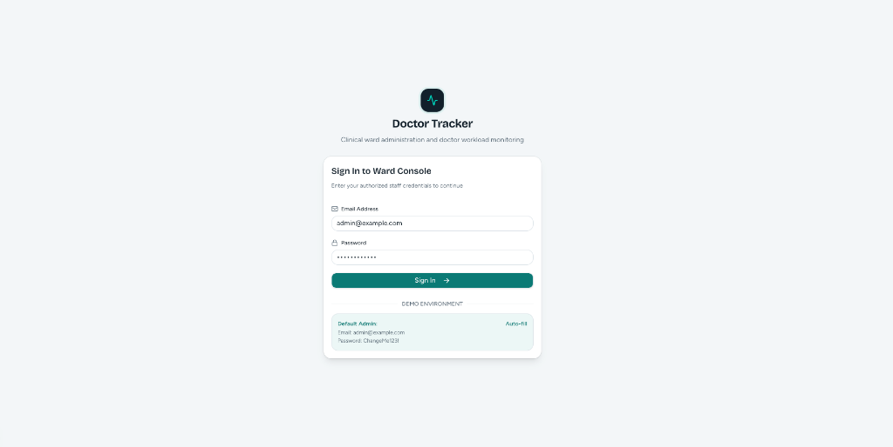
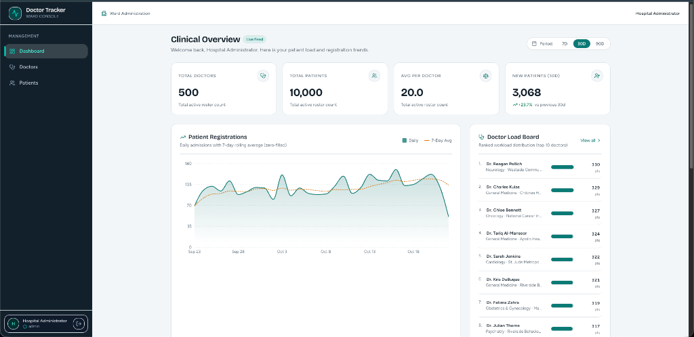
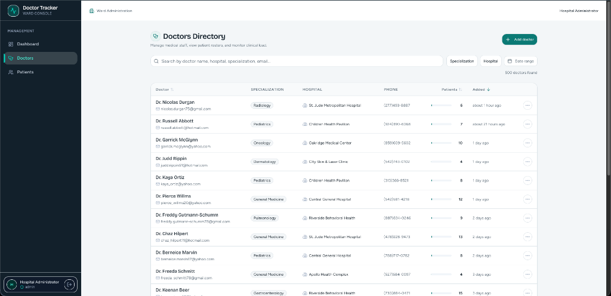

# Doctor Tracker — Frontend Client

> Modern, responsive administrative portal for managing doctors, patient rosters, and healthcare operational analytics. Built with Next.js 15 (App Router), React 19, TypeScript, and Tailwind CSS.

[](https://nextjs.org/)
[](https://react.dev/)
[](https://www.typescriptlang.org/)
[](https://tailwindcss.com/)
[](https://ui.shadcn.com/)

---

## 1. Elevator Pitch

**Doctor Tracker** is an intuitive, accessible hospital administrative web application that gives clinic managers real-time oversight over their healthcare teams. Administrators can effortlessly review doctor workloads, navigate deeply filtered lists of doctors and patients, inspect individual physician profiles, assign or reassign patients through zero-friction slide-over sheets, and monitor patient growth trends via an interactive clinical dashboard.

---

## 2. System Architecture & Request Flow

```
┌─────────────────────────────────┐
│     Browser (React 19 UI)       │
└────────────────┬────────────────┘
                 │
                 │ Next.js App Router (Middleware checks session cookies)
                 ▼
┌─────────────────────────────────┐
│      Next.js Client Shell       │
│  - /dashboard, /doctors, etc.   │
│  - /api/* Next.js Proxy Rewrite │ ────────┐
└─────────────────────────────────┘         │
                                            │ Server-to-server proxy rewrite
                                            │ Preserves first-party cookies
                                            ▼
                                ┌─────────────────────────┐
                                │   Express REST API      │
                                │   (Port 4000)           │
                                └─────────────────────────┘
```

### Request Flow
1. **Protected Navigation via Middleware**: Incoming requests to routes (`/dashboard`, `/doctors`, `/patients`) pass through Next.js edge middleware. Unauthenticated visits are cleanly redirected to `/login` preserving the `next` destination query parameter.
2. **Reverse Proxy Rewrite**: Next.js proxies all `/api/:path*` requests directly to the backend (`process.env.API_ORIGIN`). The browser only communicates with one origin, eliminating CORS issues and ensuring secure `httpOnly` cookie handling.
3. **Optimistic Updates & Caching**: Data interactions leverage TanStack React Query v5. Creating or removing a patient immediately updates UI state optimistically, reverting automatically if a network error occurs.
4. **URL-Synchronized Filter State**: Search parameters, active page indexes, sorting rules, and filter selections (e.g. Specialization, Hospital, Condition, Status) are synchronized with URL search params. Views are fully shareable, bookmarkable, and refresh-safe.

---

## 3. Tech Stack

- **Framework**: Next.js 15 (App Router) + React 19 + TypeScript
- **Styling**: Tailwind CSS v4 + Lucide Icons
- **Design System & Components**: Radix UI primitives & shadcn/ui (custom tailored for healthcare informatics)
- **Data Fetching & State**: TanStack React Query v5 + Axios / Fetch Client
- **Forms & Validation**: React Hook Form + Zod (`@hookform/resolvers`)
- **Data Visualization**: Recharts (with responsive containers and theme tokens)
- **Date Handling**: `date-fns`

---

## 4. Setup Guide

### Prerequisites
- [Node.js](https://nodejs.org/) (v18 or v20+ recommended)
- Running [Doctor Tracker Backend API](https://github.com/SAIFUL-SIFAT/doctor-tracker-backend) on port `4000`

### 1. Clone & Install
```bash
git clone https://github.com/SAIFUL-SIFAT/doctor-tracker-frontend.git
cd doctor-tracker-frontend
npm install
```

### 2. Configure Environment
Copy `.env.example` to `.env.local`:
```bash
cp .env.example .env.local
```
Configuration settings in `.env.local`:
```env
API_ORIGIN=http://localhost:4000
NEXT_PUBLIC_API_ORIGIN=http://localhost:4000
```

### 3. Run Development Server
```bash
npm run dev
```
Open [http://localhost:3000](http://localhost:3000) in your browser.

### 4. Build for Production
```bash
npm run build
npm start
```

---

## 5. Demo Credentials

Use these credentials to sign in on `/login`:

| Field | Value |
|---|---|
| **Email** | `admin@example.com` |
| **Password** | `ChangeMe123!` |

---

## 6. Technical Decisions (ADRs)

### ADR-1: TanStack Query + URL State (over Redux/Context)
- **Context**: The portal is predominantly driven by server state: doctor directories, patient registries, analytics charts, and scoped sub-lists.
- **Decision**: Store all server data in TanStack React Query v5 and synchronize pagination, search, and filter states directly into the browser URL query string.
- **Why**: Redux or Context requires extensive boilerplate for caching, cache invalidation, deduplication, and loading/error state management. TanStack Query combined with URL state guarantees that filter queries are shareable across colleagues, survive page reloads, and deliver instantaneous navigation via background prefetching.
- **Trade-offs**: Requires explicit query key management (`['doctors', filters]`, `['patients', filters]`).

### ADR-2: Next.js Rewrite Proxy for Authentication & API Integration
- **Context**: The client and backend run as separate microservices. Direct client-to-API requests often introduce cross-site cookie restrictions, third-party cookie blocking, and CORS configuration hurdles.
- **Decision**: Next.js acts as an API gateway proxy through `next.config.ts` rewrites, mapping `/api/*` requests directly to `http://localhost:4000/api/*`.
- **Why**: The browser communicates exclusively with the frontend origin. Cookies remain first-party (`SameSite=Lax`), preventing XSS token leaks while ensuring sessions are immune to cross-origin browser policies.

---

## 7. Visual Evidence (Key Views)

The UI was crafted with rich typography, glassmorphism accents, and healthcare-themed slate/teal palettes.

### 1. Secure Ward Authentication (`/login`)
Admin login console featuring auto-fill credentials for demo exploration, input validation, and secure session cookie issuance.

<p align="center">
  
</p>

---

### 2. Clinical Overview Dashboard (`/dashboard`)
Comprehensive clinical operations dashboard showcasing real-time KPI metrics, 7-day rolling average patient admission curves (Recharts), and the signature **Doctor Load Board** ranking physician workloads with proportional capacity indicators.

<p align="center">
  
</p>

---

### 3. Doctors Directory (`/doctors`)
Physician directory featuring instant prefix search across name, email, specialization, and hospital. Displays proportional workload metrics, deep filtering, and slide-over doctor registration.

<p align="center">
  
</p>

---

### Feature Summary Table

| View | Description | Key Features |
|---|---|---|
| **Executive Dashboard** | Real-time clinical overview | 4 KPI cards (Doctors, Patients, Avg Load, 30d Registrations), Patient Registrations area chart (with 7d moving average), Doctor Load Board ranking, Medical Conditions & Specializations breakdown |
| **Doctors Directory** | Complete physician roster | Instant prefix search, specialization filters, hospital filter, doctor workload visualizer bars, and slide-over doctor creation sheet |
| **Doctor Detail** | Dedicated physician workspace | Doctor contact info, summary metrics, and scoped patient roster with direct patient enrollment & unassign actions |
| **Patient Directory** | Global patient management | Multi-faceted filtering (Condition, Status, Registered Date range, Doctor assignment), inline patient editing, and deletion with confirmation dialog |
| **Mobile Experience** | Designed for 360px–768px viewports | Bottom navigation bar, adaptive card-mode data tables, and full-screen bottom sheets for filtering & data entry |

---

## 8. Accessibility & Responsiveness

- **Keyboard Navigation**: Full keyboard tab order across tables, dialogs, dropdowns, and form sheets with automatic focus trapping.
- **Mobile First**: Tables automatically transform into readable card lists on screens `< 768px`.
- **Screen Reader Friendly**: Explicit `aria-label`, `aria-describedby` error bindings on all form inputs, and semantic `<main>`, `<nav>`, `<header>` landmark hierarchy.
- **Micro-Interactions**: Smooth data transitions, skeleton loaders on each independent widget, and gentle feedback upon creating or deleting records.
